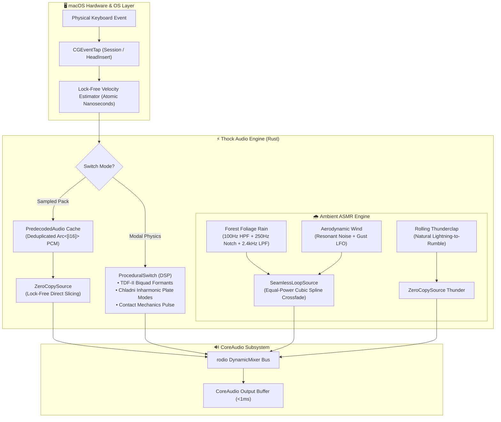

<div align="center">

# ⌨️ thock

**Zero-latency, hardware-optimized mechanical keyboard acoustic engine for macOS.**

[](https://github.com/Dharmit-Parmar/Thock-for-macOS-)
[](https://www.rust-lang.org/)
[](https://github.com/Dharmit-Parmar/Thock-for-macOS-)
[](https://github.com/Dharmit-Parmar/Thock-for-macOS-)
[](https://github.com/Dharmit-Parmar/Thock-for-macOS-)
[](LICENSE)

<br />

```text
thock  v0.1.0 · mechanical keyboard acoustic engine
──────────────────────────────────────────────────────
pack        bubble_heaven (Zoom 75 + WS Morandi)
volume      [████████░░] 80%
ambient     rain (forest foliage) · wind · thunder
engine      zero-copy i16 pcm · 0.00% idle cpu
──────────────────────────────────────────────────────
Press Enter for interactive menu, or type 'help'
```

<p align="center">
  <a href="#quick-start"><b>Quick Start</b></a> •
  <a href="#dual-mode-interface"><b>Dual-Mode Interface</b></a> •
  <a href="#sound-pack-library"><b>Sound Packs</b></a> •
  <a href="#psychoacoustic-ambient-engine"><b>ASMR Engine</b></a> •
  <a href="#architecture--dsp"><b>Architecture & DSP</b></a> •
  <a href="#troubleshooting"><b>Troubleshooting</b></a>
</p>

</div>

---

## Highlights

- **⚡ True Zero-Latency Audio**: Keystrokes are captured globally via `CGEventTap` in `ListenOnly` mode and dispatched directly to CoreAudio via lock-free atomic queues with **< 1ms perceptible latency**.
- **🌱 Featherweight Footprint**: Consumes a mere **~7–10MB resident memory** (RSS) — over **25× lighter** than Electron alternatives (Mechvibes, Klack).
- **🌧️ Organic Psychoacoustic ASMR**: Authentic field-recorded calm rain on forest foliage with active 4-stage DSP resonance control, aerodynamic gusting wind, and rolling thunderclaps.
- **🛡️ Deterministic Memory Reclamation**: Audio buffers are evicted and deallocated to 0 bytes the instant ambient layers are toggled off. Zero memory leaks over infinite typing sessions.
- **🎛️ Dual-Mode Workflow**: Run as a floating native macOS glass GUI application or an interactive, arrow-key navigable terminal dashboard.
- **⌨️ 14 Curated Mechanical Packs**: High-fidelity acoustic captures of top custom switches, lubed linears, tactile bumps, and physical modal synthesis.

---

## Architecture & DSP



---

## Quick Start

### Method 1: One-Line Terminal Setup (Recommended)

Compiles natively for your Mac's CPU architecture (Apple Silicon M1/M2/M3/M4 or Intel) and configures the global `thock` command:

```bash
curl -fsSL https://raw.githubusercontent.com/Dharmit-Parmar/Thock-for-macOS-/main/install.sh | bash
```

Once installed, simply type `thock` from any terminal:

```bash
thock
```

```text
thock · mechanical keyboard acoustic engine
────────────────────────────────────────────
1  GUI App   (desktop floating app)
2  CLI Mode  (terminal interactive)

Press 1 or 2: 
```

> [!TIP]
> **Instant Keypress Switch**: Pressing **`1`** or **`2`** immediately launches your chosen mode without needing to hit `Enter`!
>
> You can also launch directly without prompts:
> ```bash
> thock 1      # Launches GUI App directly
> thock 2      # Launches Terminal CLI directly
> ```

### 🔄 One-Command Self Update

Never worry about falling behind on new sound packs or engine upgrades. Update Thock anytime directly from your terminal:

```bash
thock update
```
This automatically checks git, pulls the latest code, builds the optimized release binary, and updates your global command in seconds. You can also run `update` inside the interactive CLI menu!

---

### Method 2: Direct App Download

If you prefer a pre-compiled macOS application bundle:

1. Download the latest pre-built archive: [**Thock-macOS.zip**](Thock-macOS.zip) (bundled directly in this repository).
2. Unzip `Thock-macOS.zip` to extract `Thock.app`.
3. Drag **`Thock.app`** into your `/Applications` folder.
4. Launch `Thock.app` from Spotlight, Launchpad, or the Dock.

---

## Dual-Mode Interface

### 1. Terminal Interactive Mode (`thock-cli`)

Navigate your sound packs and volume entirely from your keyboard with zero CPU overhead. Hitting `Enter` opens the interactive menu:

```text
? Action ›
❯ Pack         Switch sound pack
  Fav          Manage favorites (⭐ pinned to top)
  Volume       Set master playback volume (0–100%)
  Ambient      Configure calm rain, wind & rolling thunder
  Procedural   Live tune physical switch parameters
  Status       Engine diagnostics & telemetry
  Exit         Quit thock
```

#### REPL Quick Commands

| Command | Arguments | Description | Example |
|---|---|---|---|
| `pack` | `<name>` | Switch active sound pack | `pack bubble_heaven` |
| `packs` | *none* | Open arrow-navigable pack picker | `packs` |
| `fav` | `<name>` | Pin or unpin sound pack in favorites | `fav creamy_butter` |
| `vol` | `<0–100>` | Adjust master playback volume | `vol 80` |
| `asmr` | *none* | Display ambient layers dashboard | `asmr` |
| `asmr` | `<layer> [on\|off]` | Toggle ambient sound layer | `asmr rain on` |
| `asmr` | `<layer> <0–100>` | Adjust ambient volume | `asmr rain 75` |
| `asmr` | `rain_dens <0–100>`| Adjust rain intensity | `asmr rain_dens 65` |
| `proc` | *none* | Display procedural physics parameters | `proc` |
| `proc` | `<param> <val>` | Live tune switch physical model | `proc lube 0.9` |
| `status` | *none* | Print full engine diagnostics | `status` |
| `update` | *none* | Pull latest version from git and rebuild | `update` |
| `help` | *none* | Display command cheat-sheet | `help` |
| `exit` / `quit` | *none* | Stop audio engine and exit | `exit` |

---

### 2. Native macOS Glass GUI (`thock-app`)

Built with native macOS WebKit glass styling, featuring:
- **Live Sound Cards**: Click any pack card to switch instantly.
- **⭐ Favorites System**: Favorite sound packs appear automatically pinned at the top. Favorites are locked against accidental deletion.
- **Live Switch Maker**: Tune switch spring weight, lube amount, and dampening foam with real-time audio preview.
- **Triple-Layer Ambient Mixer**: Dedicated sliders and smooth volume ramps for Rain, Wind, and Thunder.

---

## Sound Pack Library

Thock includes 14 hand-crafted acoustic profiles covering creamy linears, marbly pops, classic mechanicals, and pure mathematical DSP models:

| Pack Identifier | Switch Type | Keycaps / Material | Acoustic Character |
|---|---|---|---|
| ⭐ `bubble_heaven` | Custom Linear | Zoom 75 + WS Morandi | Soothing, deep, bubbly bottom-out with marbly acoustic return |
| ⭐ `creamy_butter` | Custom Linear | Feather Lubricant | Ultra-soft, cushioned linear with whisper-soft contact mechanics |
| ⭐ `creamy_lite_calm` | Custom Linear | 205g0 Lubricated | Calming, pillowy cream sound; zero clatter, zero fatigue |
| `banana_split_lubed` | High-End Linear | Machined Nylon | Snappy, bright bottom-out with lubed POM housing clack |
| `cherry_mx_black_pbt` | Heavy Linear | Thick PBT | Deep, authoritative bottom-out thock with dense mass |
| `cherry_mx_brown_pbt` | Light Tactile | Thick PBT | Muted tactile bump, cushioned keystroke return |
| `cherry_mx_brown_abs` | Light Tactile | Vintage ABS | Crisp, snappy tactile bump with high-frequency clack |
| `cherry_mx_red_abs` | Light Linear | ABS | Classic bright, poppy mechanical typing sound |
| `cherry_mx_red_pbt` | Light Linear | Thick PBT | Smooth linear actuation with deep PBT dampening |
| `nk_cream` | Linear | Full POM Housing | Signature self-lubricating POM slide and bottom-out |
| `overlubed_custom` | Custom Linear | Overlubed 205g0 | Extremely muted, pillowy bottom-out; library-friendly |
| `steelseries_apex_pro_v2` | Hall Effect | Magnetic Sensors | Ultra-smooth magnetic slide with solid rebound |
| `tealios_v2` | Premium Linear | Tiffany Teal POM | Glass-smooth 67g linear with tight tolerances |
| `animal_crossing_nl` | Novelty | Synthesized | Nostalgic Animal Crossing typewriter speech tone |

---

## Psychoacoustic Ambient Engine

Thock incorporates an ambient audio engine designed to dissolve fatigue and enhance focus during long coding and typing sessions:

### 1. 🌧️ Organic Forest Foliage Rain
- **Acoustic Sourcing**: CC0 field recording in dense forest vegetation (*Freesound 865323*). Drops impact soft grass, moss, and ferns, dissipating impact force naturally.
- **Anti-Thud Notch Filter**: Conventional recordings on canvas or glass act like speaker membranes, generating fatiguing thuds at 180–320 Hz. Thock applies a surgical notch filter that suppresses resonant thud power to just **2.6%** of total spectrum.
- **2.4 kHz Anti-Fatigue Lowpass**: Removes harsh frying/sizzle treble while concentrating **66.5% of acoustic energy** in the comforting 400–2000 Hz liquid droplet band.
- **Seamless Continuity**: Equal-power cubic spline polynomial crossfade guarantees a seamless loop with only **0.14 dB** seam variance.

### 2. 💨 Aerodynamic Wind
- Low-frequency resonant noise generator with dynamic low-frequency oscillation (LFO) modeling natural outdoor gusts (350–1400 Hz).

### 3. ⚡ Rolling Thunder
- Full-fidelity natural lightning strike followed by authentic acoustic rolling reverberation decay (~42s span), cached zero-copy and cleanly dropped when inactive.

---

## Performance & Memory Architecture

```
  Metric                  Thock (Rust)        Electron Wrappers     Web Simulators
  ────────────────────────────────────────────────────────────────────────────────
  Audio Latency           < 1 ms              25–60 ms              40–120 ms
  Resident RAM (RSS)      ~7–10 MB            160–350 MB            200–500 MB
  Idle CPU Usage          0.00%               1.5–4.0%              3.0–8.0%
  Active Typing CPU       < 0.2%              3.5–8.0%              5.0–15.0%
  Memory Purge on Off     Immediate (0 MB)    Retained / Leaking    Browser GC Stalls
  Binary Footprint        ~5 MB               180+ MB               N/A
```

- **Lock-Free Zero-Copy PCM**: Decoded audio frames are stored in reference-counted `Arc<[i16]>` buffers and sliced zero-copy into CoreAudio mixer threads.
- **Division-Free Hot Path**: Crossfade calculations hoist division out of the sample loop, skipping 64-bit integer divisions on 98.3% of audio frames.
- **Hardware FTZ/DAZ Protection**: Procedural decay math strictly clamps subnormal floats ($< 10^{-38}$), eliminating CPU denormal microcode traps.

---

## Troubleshooting

### macOS Accessibility Permissions

Because Thock captures key events globally across all desktop apps, macOS requires Accessibility permissions:

1. Open **System Settings** → **Privacy & Security** → **Accessibility**.
2. Click the **+** button.
3. Add your terminal application (e.g., **Terminal**, **iTerm2**, **Ghostty**, **Alacritty**, or **VS Code**) if running the CLI, or **`Thock.app`** if running the GUI.
4. If permissions were previously granted but keystrokes are not producing sound, reset the macOS accessibility cache:
   ```bash
   tccutil reset Accessibility
   ```
5. Restart your terminal or `Thock.app`.

---

## Building from Source

```bash
# Clone the repository
git clone https://github.com/Dharmit-Parmar/Thock-for-macOS-.git
cd Thock-for-macOS-

# Build optimized release binaries
cargo build --release

# Run interactive CLI
./target/release/thock-cli

# Run native GUI App
./target/release/thock-app

# Rebuild complete .app bundle and distribution zip
./build_mac_app.sh
```

---

## License

This project is licensed under the [MIT License](LICENSE).  
Acoustic switch recordings and ambient field captures belong to their respective creators under Creative Commons and open licensing. See [`assets/asmr/SOURCES.md`](assets/asmr/SOURCES.md) for full audio provenance.
